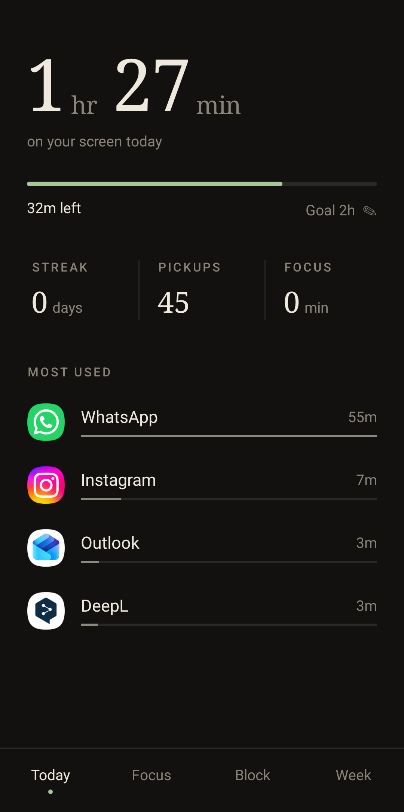
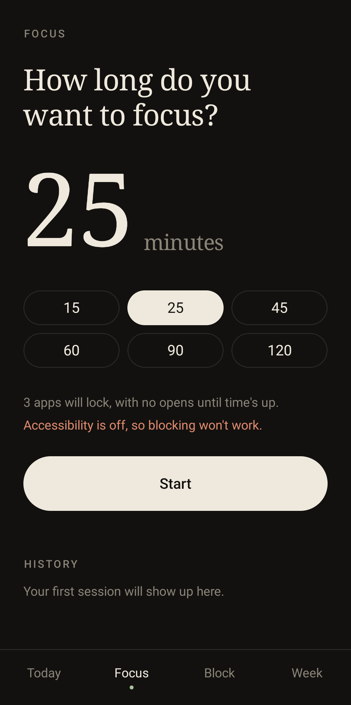
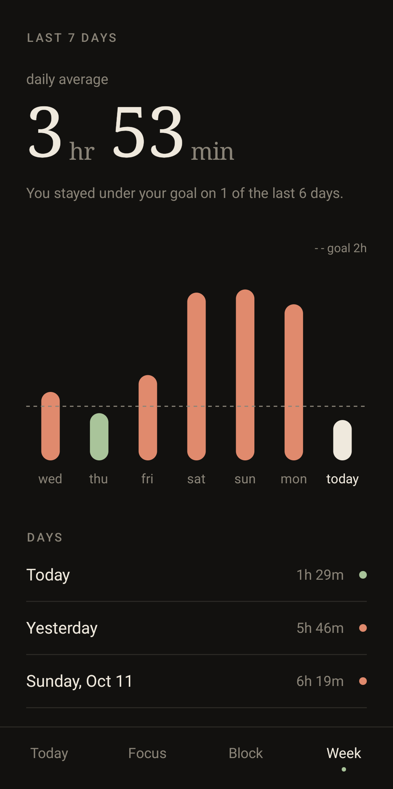
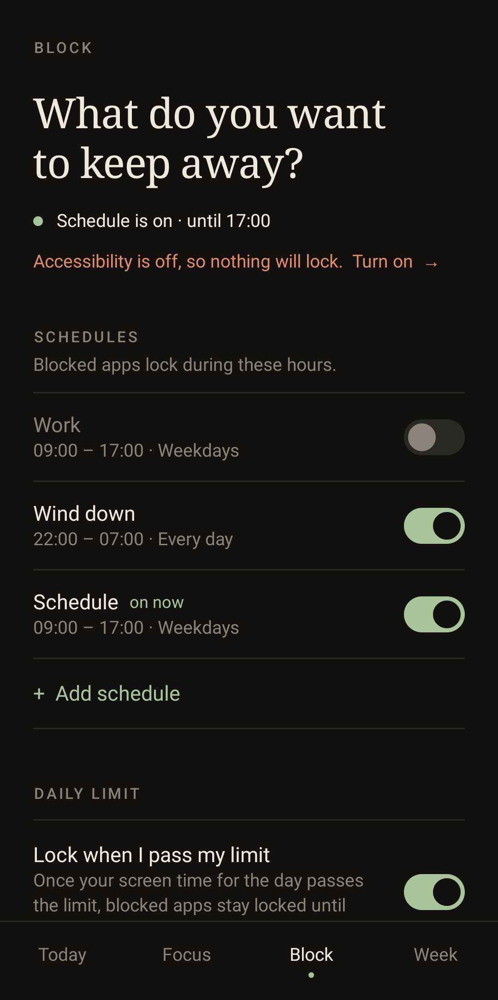
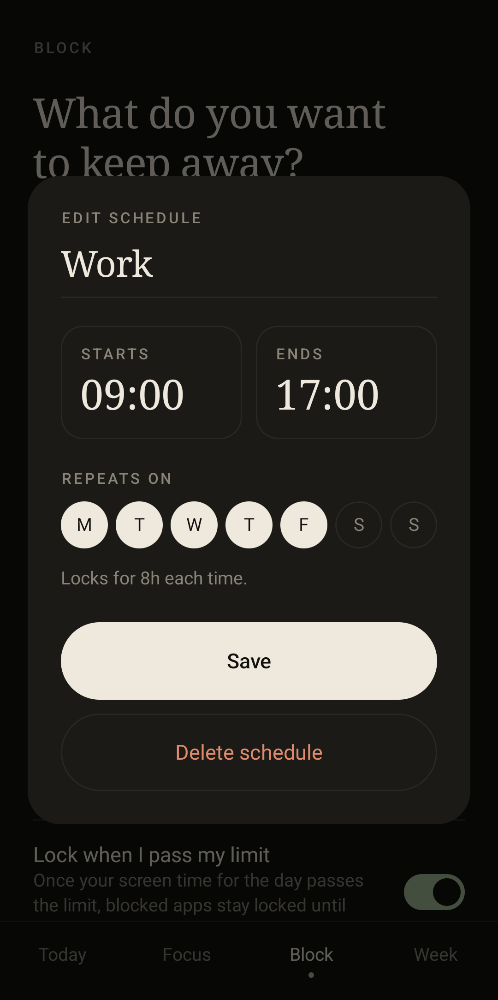
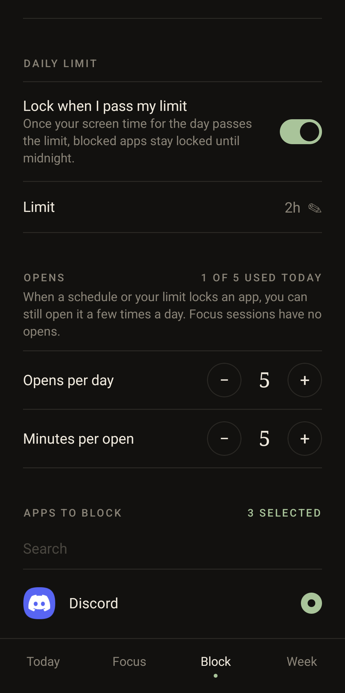

# Present

A quiet screen-time app for Android. Track your screen time, block distracting apps on a schedule, and run focus sessions — no account, no login, nothing leaves your phone.

<p>
  
  
  
</p>
<p>
  
  
  
</p>

## Features

- **Today** — screen time, progress toward a daily goal, streak, pickups, focus minutes and your most used apps.
- **Focus sessions** — 15 to 120 minutes. Blocked apps stay locked until the timer ends.
- **Schedules** — lock apps during set hours (e.g. *Work, 09:00–17:00, weekdays*). Name, times and days are editable, and overnight windows work.
- **Daily limit** — once you pass your daily screen time, blocked apps lock until midnight.
- **Opens** — a limited number of short unlocks per day (5 × 5 min by default, both adjustable). Focus sessions get none.
- **Week** — the last 7 days at a glance, against your goal.

## Build

Requires JDK 17 and the Android SDK (platform 34).

```bash
./gradlew assembleDebug
adb install app/build/outputs/apk/debug/app-debug.apk
```

## Permissions

Present asks for two permissions on first launch:

- **Usage access** — to read screen time from Android's usage stats.
- **Accessibility** (Present Blocker) — to notice when a blocked app opens and show the block screen. It does not read or record screen content.

All data is stored locally on the device.

## Contributing

Contributions are welcome. Fork the repo, make your changes and open a pull request. Bug reports and ideas are welcome as issues too.

## License

[MIT](LICENSE) — free to use, modify and share.
